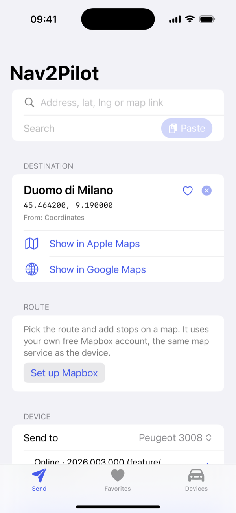
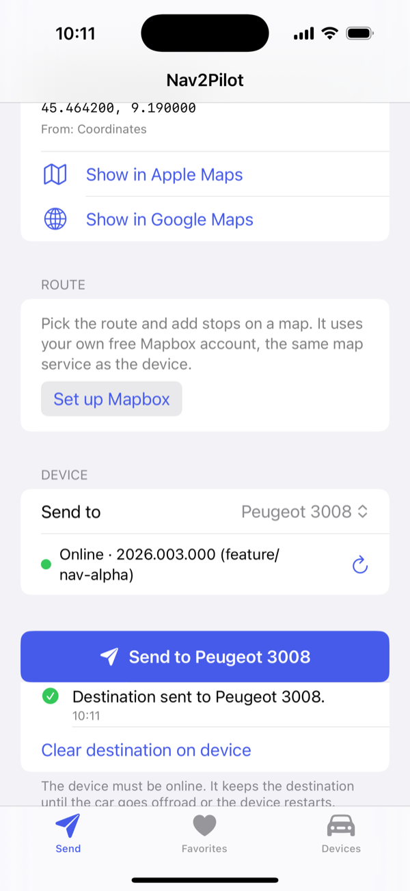
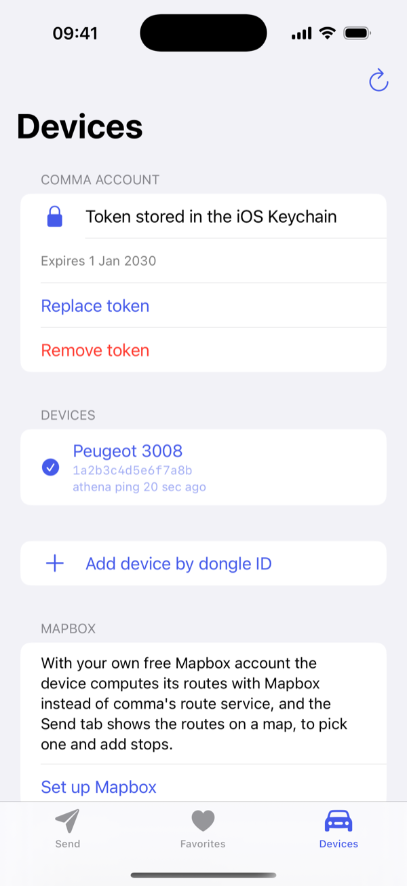
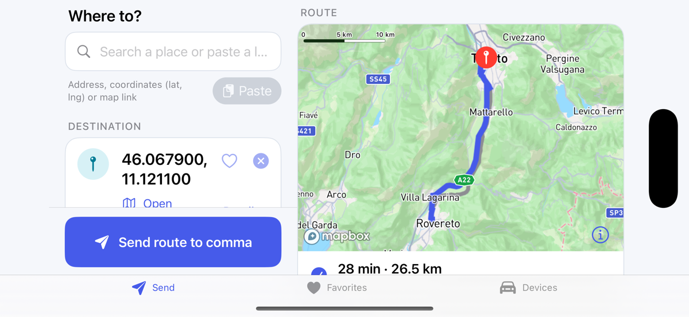

# Nav2Pilot for iOS

**Send a destination from your iPhone to your comma device in a couple of taps.**

Find a place in Google Maps or Apple Maps, tap **Share → Nav2Pilot**, pick your car, done: the destination
shows up on your comma device running openpilot or sunnypilot with Nav Alpha. No typing on the car screen.

<p align="center">
  
  &nbsp;&nbsp;
  
</p>

## Try it on TestFlight

Nav2Pilot for iOS is in beta on TestFlight. Want to try it? Write to me through
[cristianku.com](https://cristianku.com) with the e-mail address of your Apple ID and I'll add you as a
tester: TestFlight then sends you the invitation.

On Android? There is [Nav2Pilot for Android](https://github.com/cristianku/nav2pilot) too.

## Getting started

1. **Get your comma token.** Open [jwt.comma.ai](https://jwt.comma.ai), sign in with the account your comma
   device is paired to, and copy the token.
2. **Add it to the app.** **Devices → Add token**, paste it, **Verify and save**. Your devices show up in the
   list.
3. **Send a place.** In Google Maps or Apple Maps open a place, tap **Share** and choose **Nav2Pilot** (the
   first time it may be under **More**), then **Send to …**. That's it.

You can also type an address, paste a map link or coordinates in the **Send** tab, and keep your favourite
places one tap away.

## What you need on the car

- openpilot or sunnypilot with **Nav Alpha**, the navigation comma added to openpilot in October 2026. Older
  software doesn't have it, and the app tells you so.
- The comma device must be **online** when you send.
- The car keeps the destination until it goes off-road or the device restarts.

## Optional: your own Mapbox account

Nav Alpha asks comma's route service for the route. In my tests that service refused a device without comma
prime, and the car stayed on "Waiting for route". With your own free Mapbox account:

- the app shows the route on a map: pick one of the alternatives, long-press to add stops;
- the car computes its route with your Mapbox account instead of comma's service.

The car part needs one of these two builds, with Nav Alpha and the token support:

- sunnypilot: [cristianku/sunnypilot `feature/nav-alpha`](https://github.com/cristianku/sunnypilot/tree/feature/nav-alpha)
- openpilot: [cristianku/openpilot `nav-alpha`](https://github.com/cristianku/openpilot/tree/nav-alpha)

On any other software the token simply stays on your phone and everything else works as usual.

Set it up in **Devices → Mapbox → Set up Mapbox**, the app walks you through it:

1. Create a free Mapbox account. Without a payment card Mapbox only gives you a trial token with low limits;
   with a card you get the free tier, which is plenty for personal use.
2. Copy the **Default public token** (it starts with `pk.`).
3. Paste it in the app. From then on it goes to the car by itself, with every destination you send.

<p align="center">
  
</p>

## Landscape, iPad and CarPlay

Turn the iPhone on its side, or use an iPad, and the Send tab switches to two panes: search, destination and
the send button on the left, the route map on the right.

<p align="center">
  
</p>

CarPlay is not supported yet. CarPlay does not show ordinary apps: an app needs a dedicated car screen built
from CarPlay templates, and a CarPlay entitlement that Apple grants on request. On Android, Nav2Pilot also
runs on CarlinKit boxes that run Android (see the
[Android README](https://github.com/cristianku/nav2pilot#car-screens-carlinkit-android-auto-carplay)).

## If something doesn't work

- **"The comma token was rejected (HTTP 401)"**: the token has expired. Get a new one at
  [jwt.comma.ai](https://jwt.comma.ai) and replace it in Devices.
- **"Device unreachable"**: the comma device is offline. Try again when it's on and connected.
- **The car shows "Waiting for route"**: see "Optional: your own Mapbox account" above.

## Privacy

- Your comma token and your Mapbox token stay in the iOS Keychain of your iPhone: never synced, never logged.
- The app only talks to comma (to reach your device), to Google and Apple Maps (to open shared links) and, if
  you set it up, to Mapbox. No analytics, no tracking.
- Your position is used only for the route preview, and only Mapbox gets it.

Nav2Pilot is an independent project, not affiliated with comma.ai or sunnypilot.

---

## Technical details

Swift, SwiftUI, iOS 17+. Bundle ID `com.cristianku.nav2pilot`. iOS counterpart of
[Nav2Pilot for Android](https://github.com/cristianku/nav2pilot): same API calls, same link rules, same
tests. It only talks to documented network APIs, independently of the openpilot / sunnypilot source code.

### Features in detail

- **Share extension**: "Nav2Pilot" in the share sheet of Google Maps, Apple Maps or any app that shares a
  link or text. The destination is resolved and sent from the share sheet itself, without leaving the
  map app.
- Coordinates from full Google Maps URLs, Maps URLs API links (`api=1`), legacy `q=` / `ll=` / `daddr=`
  links, `geo:` URIs, `google.navigation:` URIs and Apple Maps links. Short links (`maps.app.goo.gl`,
  `maps.apple/p/…`) are expanded by following redirects.
- Manual entry: `lat, lng`, a pasted link, or an address search (Apple MapKit).
- **Mapbox (optional)**: your own Mapbox token is sent to the device, which then asks Mapbox for its routes
  instead of comma's route service (see "Mapbox token on the device"). The Send tab shows the fastest route and
  up to two alternatives from the phone's position, stops added with a long press. The device follows the
  route you pick (see "Waypoints").
- Several devices: all devices of the comma account, plus devices added by dongle ID.
- Connection status (athena `getVersion`: shows the version and branch running on the device).
- Send and clear the destination, with confirmation or a precise error.
- Favorite destinations.
- comma token stored in the iOS Keychain, on this iPhone only.
- `geo:` links open in Nav2Pilot.

### comma token

The token is checked with `GET /v1/me/` before it is stored. If the token carries an `exp` claim the app
shows its expiry date; the token lifetime is not documented in the sources below, so when sending starts
failing with HTTP 401, generate a new token.

### Verified API

Everything Nav2Pilot sends is taken from source code or official documentation:

| What | Source |
|------|--------|
| `POST https://athena.comma.ai/<dongle_id>` with a JSON-RPC 2.0 body is relayed to the device's websocket | <https://api.comma.ai> ("Athena"), [commaai/comma-api `openapi.yaml`](https://github.com/commaai/comma-api/blob/master/openapi.yaml) (`/{dongleId}` on server `https://athena.comma.ai`) |
| Auth header `Authorization: JWT <token>`, tokens from jwt.comma.ai | <https://api.comma.ai> ("Authentication"); openpilot `tools/lib/api.py` |
| API host `https://api.commadotai.com` | openpilot `common/api/comma_connect.py`, `tools/lib/api.py` |
| `GET /v1/me/devices/`: `dongle_id`, `alias`, `device_type`, `last_athena_ping`, `is_owner` | <https://api.comma.ai> ("List devices"), `openapi.yaml` `Device` schema |
| `GET /v1/me/` validates a token (`/v1/me` without the slash answers 308, and the redirect loses the `Authorization` header) | openpilot `tools/lib/auth.py`; redirect checked 2026-10-17 |
| `setNavDestination(latitude: float, longitude: float)` returns `{"success": 1}`, or `{"success": 0, "error": "Invalid destination coordinates"}` out of range | commaai/openpilot `openpilot/system/athena/athenad.py`; sunnypilot `feature/nav-alpha` same file |
| `clearNavDestination()` returns `{"success": 1}` | same file |
| Both write/remove the `NavDestination` param (JSON `{"latitude", "longitude"}`) that `navd` routes to | `openpilot/selfdrive/navigation/navd.py` |
| `NavDestination` flags `CLEAR_ON_MANAGER_START \| CLEAR_ON_OFFROAD_TRANSITION` | `openpilot/common/params_keys.h`, applied in `openpilot/system/manager/manager.py` |
| JSON-RPC errors: `-32601` method not found, `-32602` invalid params, `-32000` server error | `openpilot/system/athena/rpc.py` |
| `getVersion()` returns `version`, `remote`, `branch`, `commit`, `commit_date` | `openpilot/system/athena/athenad.py` |
| A queued message returns the result string "Device offline, message queued" | <https://api.comma.ai> ("Athena") |

Notes:

- Only `latitude` and `longitude` are sent. The comma-api schema still lists `place_name` and
  `place_details` for `setNavDestination` (the pre-2026 signature), but the current athenad function takes
  exactly two parameters, and the device's dispatcher answers unknown keyword arguments with `-32602`.
- athena's offline queue is documented for "some specific methods"; the schema only lists
  `uploadFilesToUrls` there. Nav2Pilot therefore expects the device to be online and does not set `expiry`.
- athena's HTTP error bodies for unknown or offline devices are not documented; the app shows the HTTP
  status and whatever text the server returns.
- `clearNavDestination` is in the device code but not in the comma-api schema.

#### Google Maps links

- `maps.app.goo.gl` links are expanded one redirect at a time, reading only the `Location` header and
  only on Google hosts. The EU consent interstitial (`consent.google.com/...?continue=<maps url>`) is not
  fetched: its `continue` parameter already contains the Maps URL.
- In expanded place URLs the pin is `!3d<lat>!4d<lng>` inside `data=`. This is **not a documented
  format**, only observed in real redirects; it is preferred over the `@lat,lng,zoom` viewport, which can
  be kilometres away from the place. A viewport-only result is marked approximate.
- When a link has no coordinates, the shared address lines (or the place name) are geocoded.

#### Apple Maps links

- Unified Maps URLs, documented in Apple's
  ["Adopting unified Maps URLs"](https://developer.apple.com/documentation/mapkit/unified-map-urls)
  (iOS 18.4+): `/place?coordinate=&name=&address=` (exact pin), `/directions?destination=`,
  `/search?query=`, `/frame?center=` (map centre only, marked approximate).
- Older Map Links parameters: maps.apple.com redirects them to the unified form (checked 2026-10-17),
  and Nav2Pilot applies the same mapping without the network: `ll`+`q` → `/place?coordinate=<ll>&name=<q>`,
  `ll` alone → `/frame?center=`, `daddr` → `/directions?destination=`, `q` → `/search?query=`,
  `address` → `/place?address=`.
- `maps.apple/p/…` short links are expanded like Google short links, contacting only `maps.apple` and
  `maps.apple.com`. Their redirect target has not been checked with a real shared link yet; if it carries
  no coordinates, the shared text is geocoded as for Google.

### Route map and waypoints

The map uses the user's **own free Mapbox account**: Devices → Mapbox → Set up Mapbox opens Mapbox's
sign-up and Tokens pages, then the Default public token (`pk.…`) is pasted, checked with Mapbox's Tokens API
(`GET https://api.mapbox.com/tokens/v2`, answer `TokenValid`) and stored in the Keychain. Secret tokens (`sk.…`)
are refused. Mapbox has no API for a third-party app to create an account or a token, and comma's own Mapbox
proxy (`api.commadotai.com/v1/nav`, used by navd) accepts only device tokens (HTTP 401 with an account token,
checked 2026-10-17).

- Routes come from the Directions API with the same profile as the device's navd, `mapbox/driving-traffic`
  (`openpilot/selfdrive/navigation/navd.py`), from the phone's position (location permission "when in use").
- **Waypoints** need the method `setNavRoute(latitude, longitude, waypoints)`, in
  [cristianku/sunnypilot `feature/nav-alpha`](https://github.com/cristianku/sunnypilot/tree/feature/nav-alpha)
  (`sunnypilot/navd/athena.py`, `sunnypilot/navd/navd.py`) and in
  [cristianku/openpilot `nav-alpha`](https://github.com/cristianku/openpilot/tree/nav-alpha)
  (`selfdrive/navigation/nav2pilot/athena.py`, `selfdrive/navigation/nav2pilot/navd.py`). Stops are sent as
  stops; for an alternative route the app sends three silent via points on it (at 25 %, 50 % and 75 % of its
  length), so the device's Mapbox request goes the same way. On comma's Nav Alpha, which has no `setNavRoute` (`-32601`), the app sends the
  destination alone and says so.
- Without a payment card Mapbox gives only a trial token with lower limits; with a card the free tiers apply
  ([Mapbox sign-up guide](https://docs.mapbox.com/accounts/guides/signup/)). The setup sheet says so.
- Google Maps cannot be used for this: its terms forbid Google content with non-Google maps and in vehicle
  devices (Google Maps Platform Terms 3.2.3 (e) and (f)), and a shared Google route only says which
  alternative was picked (`!5i1`), not its roads.

### Mapbox token on the device

On a device without comma prime (`PrimeType` 0), comma's route service `api.commadotai.com/v1/nav` answered
**HTTP 403** to every route request (route `0000011a`, 2026-10-17): navd got no route, the map stayed on
"Waiting for route".
With the method `setMapboxToken(token)` the device stores the user's public token in the `MapboxToken` param
and navd asks `api.mapbox.com` directly. It is in two builds:

- sunnypilot: [cristianku/sunnypilot `feature/nav-alpha`](https://github.com/cristianku/sunnypilot/tree/feature/nav-alpha) (`sunnypilot/navd/athena.py`)
- openpilot: [cristianku/openpilot `nav-alpha`](https://github.com/cristianku/openpilot/tree/nav-alpha) (`selfdrive/navigation/nav2pilot/athena.py`)

- Nothing to press: the app sends the token when it is saved (to the selected car) and before every
  destination, silently. The device writes it only when it changed. The `MapboxToken` param survives reboots,
  but `Params::clearAll` deletes it when the device boots a build that does not define it; the next
  destination brings it back.
- **Remove Mapbox token** also sends an empty token to the selected car, which goes back to comma's service.
- A device without `setMapboxToken` (`-32601`, unmodified openpilot) is not an error: the destination goes out
  and the feedback is the usual one.
- The map tiles of the device (mapsd) still come from comma (`v1/<dongle_id>/nav/tiles`).

### sunnylink

Investigated, **not implemented** (the `SunnylinkTransport` backend is an explicit stub):

- Verified: on the device, `sunnylinkd` imports the same JSON-RPC `dispatcher` as athenad
  (`openpilot/sunnypilot/sunnylink/athena/sunnylinkd.py`), so `setNavDestination` is reachable over the
  sunnylink websocket (`wss://athena.sunnylink.ai`).
- Found: the public [sunnylink frontend](https://github.com/sunnypilot/sunnylink-frontend) ships
  generated types for `POST https://athena.sunnylink.ai/navigation/{deviceId}/set_destination`
  (`latitude`, `longitude`, `place_name`, `place_details`), but no UI uses it and there is no documentation.
- Not available: a documented API contract, and a supported way for a third-party app to obtain a sunnylink
  token (the frontend signs users in through its own Logto OIDC client).

### Architecture

```
Nav2PilotKit/                  Swift package: everything except the UI, tested with `swift test`
  Sources/Nav2PilotKit/
    Model/                     Destination, PairedDevice, validation rules
    Parsing/                   URL splitting, coordinates, Google / Apple Maps / geo: links, shared text
    Resolve/                   short-link expansion, link -> search fallback
    Geocode/                   PlaceSearch (MapKit local search)
    Mapbox/                    user's Mapbox token check, Directions previews, via points, phone location
    Net/                       HttpClient abstraction (ephemeral URLSession, redirects one hop at a time)
    Transport/                 NavigationTransport + comma athena backend + sunnylink stub
    Security/                  Keychain store, token store, JWT expiry
    Data/                      favorites and devices (App Group UserDefaults + JSON)
    App/                       MainViewModel (Observation), AppContainer (wiring)
  Tests/Nav2PilotKitTests/     unit tests, optional network tests
App/                           SwiftUI app: Send, Favorites, Devices tabs
ShareExtension/                share sheet extension (resolves and sends without opening the app)
Shared/                        SwiftUI views used by both the app and the extension
AppTests/                      tests hosted in the app (real Keychain and App Group)
UITests/                       UI tests driving the app in the simulator
project.yml                    XcodeGen spec of Nav2Pilot.xcodeproj
```

`NavigationTransport` is the backend abstraction (`listDevices`, `checkStatus`, `setDestination`,
`clearDestination`). Each device records its backend, and `TransportRegistry` picks the implementation, so
another backend can be added without touching the UI.

The app and the share extension are separate processes. They share devices and favorites through the App
Group `group.com.cristianku.nav2pilot` and the token through the Keychain access group
`<team>.com.cristianku.nav2pilot.shared`. The app re-reads both when it comes to the foreground. If the
extension finds no stored devices but has the token, it lists them from the comma account.

### Security and privacy

- The Mapbox public token is in the Keychain too and is sent only to `api.mapbox.com` and, through athena,
  to your own device.
- The comma JWT is stored only in the iOS Keychain, with `kSecAttrAccessibleWhenUnlockedThisDeviceOnly`:
  readable only while the iPhone is unlocked, never synced to iCloud Keychain, never restored to another
  iPhone from a backup. Devices and favorites (not secret) are in the App Group's UserDefaults.
- The token is never logged (the app has no logging), is excluded from `HttpRequest.description`, and is
  not shown again after saving.
- Network traffic goes through an ephemeral URLSession (no cache, no cookies). Hosts contacted:
  `api.commadotai.com`, `athena.comma.ai`, Google Maps and Apple Maps hosts (only to expand shared short
  links), Apple's MapKit service (address search) and, only with a Mapbox token, `api.mapbox.com` (token check,
  routes; the map SDK loads its tiles from Mapbox). No analytics. The phone's position is only used for the
  route preview and sent only to Mapbox.
- The paste buttons use SwiftUI's `PasteButton`, so the clipboard is read only when you tap them.

### Build

Toolchain: Xcode 16 or newer (the project was created with Xcode 26.3 and the iOS 26.2 SDK);
deployment target iOS 17.0. One third-party dependency, the
[Mapbox Maps SDK](https://github.com/mapbox/mapbox-maps-ios) 11.33.0 (Swift Package Manager, app target only;
downloads need no credentials).

Simulator (no Apple developer account needed):

```
open Nav2Pilot.xcodeproj        # scheme Nav2Pilot, any iPhone simulator, Run
```

or from the command line:

```
xcodebuild -project Nav2Pilot.xcodeproj -scheme Nav2Pilot \
  -destination 'platform=iOS Simulator,name=iPhone 17' build
```

#### Build for an iPhone

1. Create `Config/Local.xcconfig` (ignored by git) with your team ID:

   ```
   DEVELOPMENT_TEAM = ABCDE12345
   ```

2. Open the project, select your iPhone, Run. Automatic signing registers the App Group and the Keychain
   group for both targets.

The App Group and the bundle IDs are those of this repository. With another Apple team, if
`com.cristianku.*` cannot be registered, change `PRODUCT_BUNDLE_IDENTIFIER`, the App Group in both
`.entitlements` and `AppContainer.appGroupIdentifier` together. Without a working App Group the share
extension still sends, using the device list of the comma account.

#### TestFlight (GitHub Actions)

Fastlane on GitHub Actions signs with the certificates stored in the private
`<owner>/Match-Secrets-Nav2Pilot` repository and uploads to TestFlight. The signing repository and
its encryption password are dedicated to Nav2Pilot.

One-time setup:

1. Create an empty private `<owner>/Match-Secrets-Nav2Pilot` repository. Set the repository secrets
   (Settings → Secrets and variables → Actions): `TEAMID`, `FASTLANE_KEY_ID`, `FASTLANE_ISSUER_ID`,
   `FASTLANE_KEY`, `GH_PAT`, `MATCH_PASSWORD`. `GH_PAT` must have read and write access to the private
   signing repository. Generate a dedicated `MATCH_PASSWORD` and keep a secure copy; it encrypts
   the signing files and does not grant GitHub access.
2. Run **1. Validate Secrets**.
3. Run **2. Add Identifiers**: registers `com.cristianku.nav2pilot` and `com.cristianku.nav2pilot.share`
   with the App Groups capability.
4. In [Identifiers](https://developer.apple.com/account/resources/identifiers) create the App Group
   `group.com.cristianku.nav2pilot` and assign it to both identifiers (App Groups → Configure). The App
   Store Connect API cannot do this step.
5. In [App Store Connect](https://appstoreconnect.apple.com/apps) create the app (My Apps → + → New App,
   bundle ID `com.cristianku.nav2pilot`, any SKU). The name must be unique on the App Store.
6. Run **3. Create Certificates**: creates the distribution certificate and App Store profiles for
   both identifiers in `Match-Secrets-Nav2Pilot`. This workflow never revokes existing certificates.

Then **4. Build Nav2Pilot** builds, signs and uploads to TestFlight, using the next TestFlight build
number. It also runs on the 1st of every month, because TestFlight builds expire after 90 days.

If an identifier's App Group changes after its profile was created, the profile has to be regenerated
(delete it in the developer portal, then run 3. Create Certificates again).

#### Regenerating the project

`Nav2Pilot.xcodeproj` is generated by [XcodeGen](https://github.com/yonaskolb/XcodeGen) from
`project.yml` and committed. After editing `project.yml`: `brew install xcodegen && xcodegen generate`.

### Tests

- `swift test --package-path Nav2PilotKit`: link parsing (including a real `maps.app.goo.gl` redirect
  and EU consent hop captured on 2026-10-17, and Apple Maps links), short-link expansion, resolver
  fallbacks, the exact athena JSON-RPC requests and response handling, token storage, repositories and
  the view model flow. No network access, runs on macOS without a simulator.
- `NAV2PILOT_NETWORK_TESTS=1 swift test --package-path Nav2PilotKit --filter NetworkIntegrationTests`:
  the real Google short link, Apple's redirect of a legacy link and a MapKit search. No comma token used.
- `xcodebuild test -project Nav2Pilot.xcodeproj -scheme Nav2Pilot -destination 'platform=iOS Simulator,name=iPhone 17'`:
  the package tests on iOS, the app-hosted Keychain and App Group tests, and the UI tests (typed
  coordinates → destination → favorite, `geo:` link, Devices and token screens).

### CI

`.github/workflows/ios.yml` (every push and pull request) checks that the committed Xcode project matches `project.yml`, runs the
package tests on macOS and all tests on an iPhone simulator, builds an unsigned Release for devices, and
uploads the simulator app and the test results as artifacts.

## License

MIT, see [LICENSE](LICENSE).
